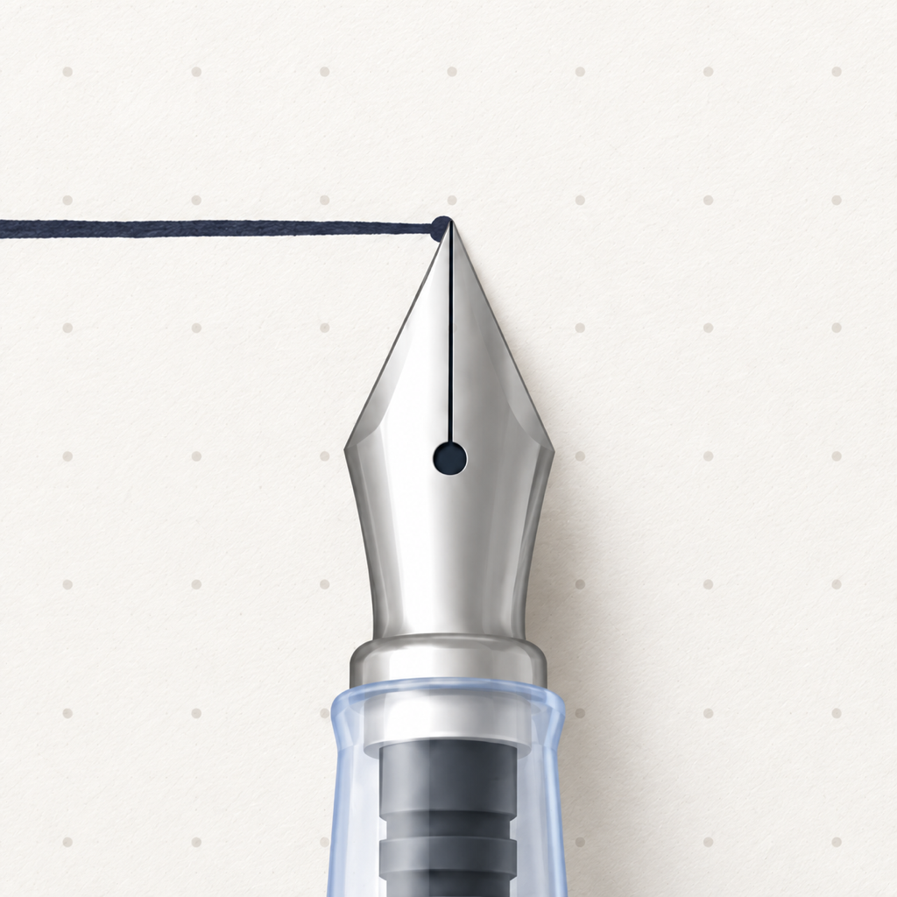

# Stylus for Android

为 Android 平板和手写笔打造的本地笔记与绘画应用。用不同的笔触书写、画图，在自己的笔记本中整理灵感。

**[下载最新 APK](https://github.com/leongao/stylus-android-releases/releases/latest)** · [安装与更新](INSTALL.md) · [更新记录](CHANGELOG.md) · [隐私说明](PRIVACY.md)

## 当前版本

**0.4.3 · build 15**。下载 Release 中的 **`Stylus-0.4.3-universal.apk`**，无需分包安装或额外素材下载。GitHub 自动生成的 Source code 压缩包是本仓库的文档，不是安装包。

- Android 10 或更高版本；面向平板和主动式手写笔优化。
- 同一个 APK 包含 arm64-v8a、armeabi-v7a、x86、x86_64。
- 开发与此前书写体验验证基于小米 Pad 7 Ultra + Xiaomi Focus Pen；其他设备的压感、倾角和系统手势支持可能不同。
- Android 13 及以上使用曲面玻璃效果，较早版本使用兼容效果。Android 10–12 的本次正式包尚未完成设备验证。

## 本次更新

- 修复钢笔每笔起点出现不自然圆点的问题。
- 保留轻压、长线和连续书写的跟手表现；已在小米 Pad + Focus Pen 上完成实笔确认。
- 已有笔迹继续按原笔刷模型恢复，保留笔宽、透明度、玻璃参数和笔迹预测设置。

## 可以做什么

- 多笔记本、多页面与 3D 封面；笔记在设备本地保存。
- 钢笔、水笔、铅笔和两种马克笔，支持笔宽、颜色和透明度调整。
- 钢笔默认透明度 60%，水笔 70%；铅笔支持压感、纹理和倾斜侧锋。
- 局部 / 整笔橡皮、套索、撤销与重做；书写时单指移纸、双指平移和缩放。
- 开本后可直接用手写笔书写或点选内容，无需先用手指激活。
- 吸管取色，吸取笔迹原色并保留当前画笔的不透明度。
- 紧凑笔盒和靠近色盘的六色槽；左侧粗细、透明度滑杆共用连续玻璃背景。
- 拖拽调整笔盒中的画笔和自定义颜色顺序；色板横向分页，笔盒内直接调 HSL。
- 添加图片，移动、等比缩放、删除与撤销；导入后保存在应用内。
- 沉浸书写、自适应胶囊控件，以及折射、色散可调的曲面玻璃面板。
- 玻璃上方的文字与图标随背景明暗调整，提升对比度。
- 通过系统文件选择器导出 PNG。

## 开始使用

1. 安装 APK 后打开 **Stylus**，在书库中新建笔记本。
2. 点笔记本进入页面，直接用手写笔书写；单指移动纸面，双指平移或缩放。
3. 点画笔选择工具，再点当前画笔调整设置；左侧两根滑杆分别调粗细和透明度，吸管可取色。色盘直接选色，下方滑条调明度。
4. 点笔盒的添加图片按钮选择图片；置入后用选择工具移动，拖动右下角等比缩放。
5. 在页面菜单中导出 PNG。PNG 是图片，不是可继续编辑的笔记本备份。

## 手势分工

- 书写与橡皮：单指移动纸面，双指平移或缩放；单指双击恢复居中视图，双指点按撤销。
- 圈选 / 移动工具：单指操作内容，双指移动或缩放画布。
- 开本翻阅：单指左右翻页。
- 平移时落笔会立即停住纸面，抬笔后原先搭着的手掌不会继续拖动。普通平移松手即停，边界有轻微回弹。

## 数据与更新

正式版包名为 `com.leon.still`。它与 **Checks / Stylus Checks** (`com.leon.still.validation`) 独立安装，数据互不迁移，安装本 APK 不会删除 Checks 中的笔记。

后续正式版使用同一专用发布签名，可以覆盖更新并保留应用数据。若系统提示与已有应用的签名冲突，请先阅读 [安装说明](INSTALL.md)，不要为了安装而删除有笔记的旧应用。

当前没有云同步或整本可编辑笔记的导入 / 导出入口。卸载或清除应用数据会删除本地笔记；系统自动备份也已关闭。

## 反馈

请在 [Issues](https://github.com/leongao/stylus-android-releases/issues) 提供应用版本、设备、Android / HyperOS 版本及复现步骤。截图或录屏请先遮挡私人笔记。

本仓库用于分发 APK、版本记录与使用文档；应用源代码未在此发布。第三方组件及其许可证见 [licenses](licenses/THIRD_PARTY_NOTICES.md)。
